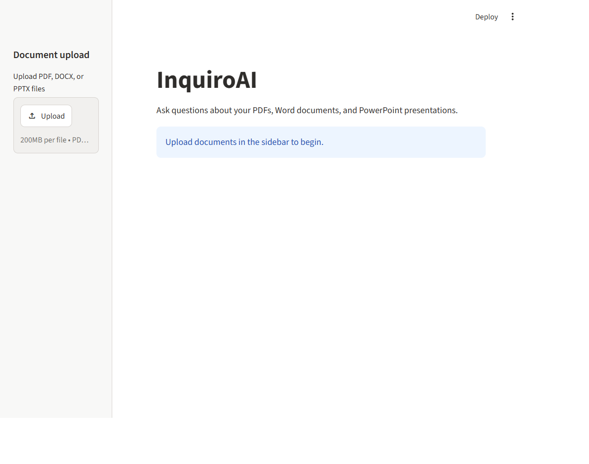
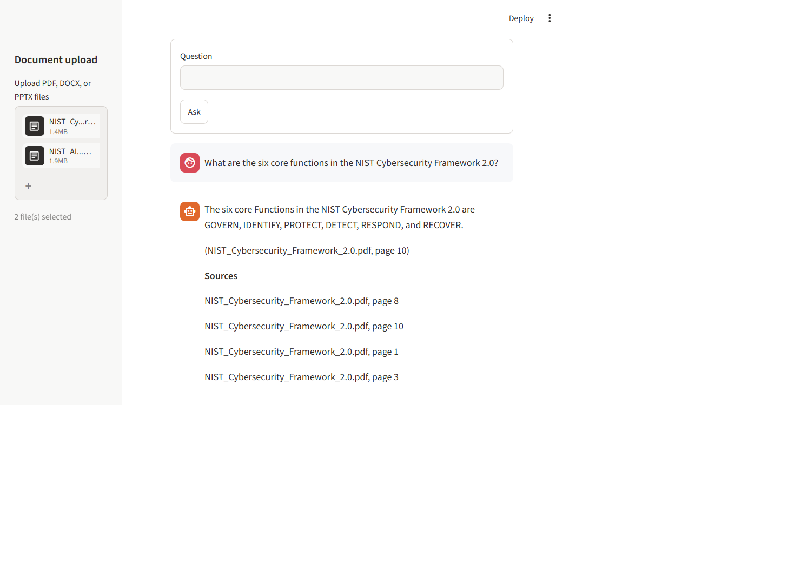

# InquiroAI

InquiroAI is a document question-answering app that retrieves relevant text and answers with source references.

## Screenshot





## Features

- Upload PDF, DOCX, and PPTX files in the Streamlit app.
- Extract selectable PDF text, Word paragraphs and tables, and PowerPoint slide text.
- Create local sentence-transformer embeddings and search them with Chroma using cosine distance.
- Generate answers from retrieved document context with the Gemini API.
- Show source file and page, slide, paragraph, or table row for retrieved text.
- Ask the model to use an exact refusal response when the documents do not contain the answer.

## How it works

1. The app extracts text while retaining each unit's file and location.
2. Text is split into overlapping chunks without crossing page, slide, or paragraph boundaries.
3. Sentence Transformers creates local embeddings, which Chroma indexes for semantic search.
4. The app retrieves the closest chunks and sends those chunks with the question to Gemini.
5. The answer and source locations are displayed in the chat.

## Run locally

Use Python 3.10 or newer. From the project folder in PowerShell:

```powershell
python -m venv .venv
.\.venv\Scripts\Activate.ps1
python -m pip install -r requirements.txt
Copy-Item .env.example .env
```

Add your Gemini API key to `.env`:

```text
GEMINI_API_KEY=your-key
GEMINI_MODEL=gemini-3.5-flash
```

Then start the app:

```powershell
streamlit run app.py
```

Upload documents from the sidebar. The first run downloads the embedding model; asking a question requires internet access and a valid Gemini API key.

## Privacy and limitations

- Embeddings and retrieval run locally in memory for the current app session.
- Retrieved document excerpts and the question are sent to Gemini to generate an answer. Do not upload sensitive documents unless you are comfortable with that.
- Gemini answer generation uses the Google GenAI `generateContent` API with a 45-second request timeout.
- Scanned PDFs without selectable text are not OCR-processed.
- The model can still produce incorrect answers or fail to refuse when evidence is missing. Check its citations against the original documents.
- PDF sources use page numbers, PPTX sources use slide numbers, and DOCX sources use paragraph or table-row numbers.

## Project files

| File | Purpose |
| --- | --- |
| `app.py` | Streamlit upload and chat interface |
| `pdf_utils.py` | Text extraction with source locations for each supported format |
| `embeddings.py` | Loads and uses the local Sentence Transformer model |
| `vectorstore.py` | Stores and retrieves embedded chunks with Chroma |
| `qa_engine.py` | Chunks documents, builds grounded prompts, and returns answers and sources |
| `llm.py` | Calls Gemini and reports API configuration or generation errors |
| `config.py` | Shared model and chunking settings |
